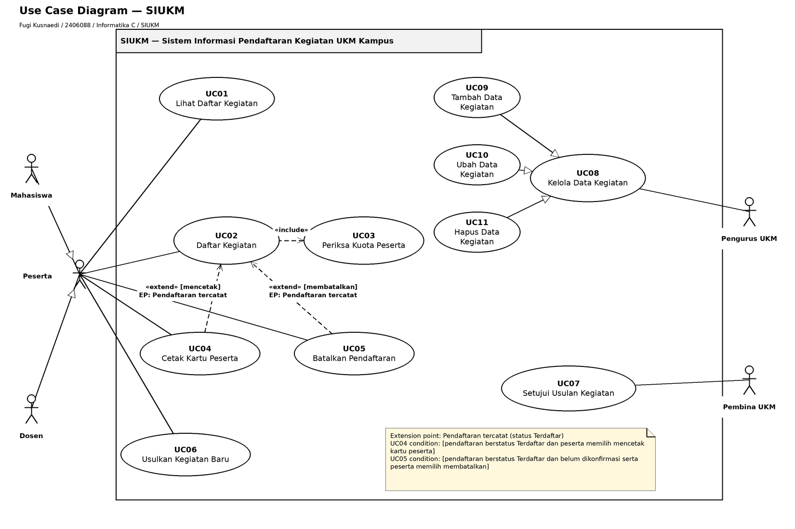
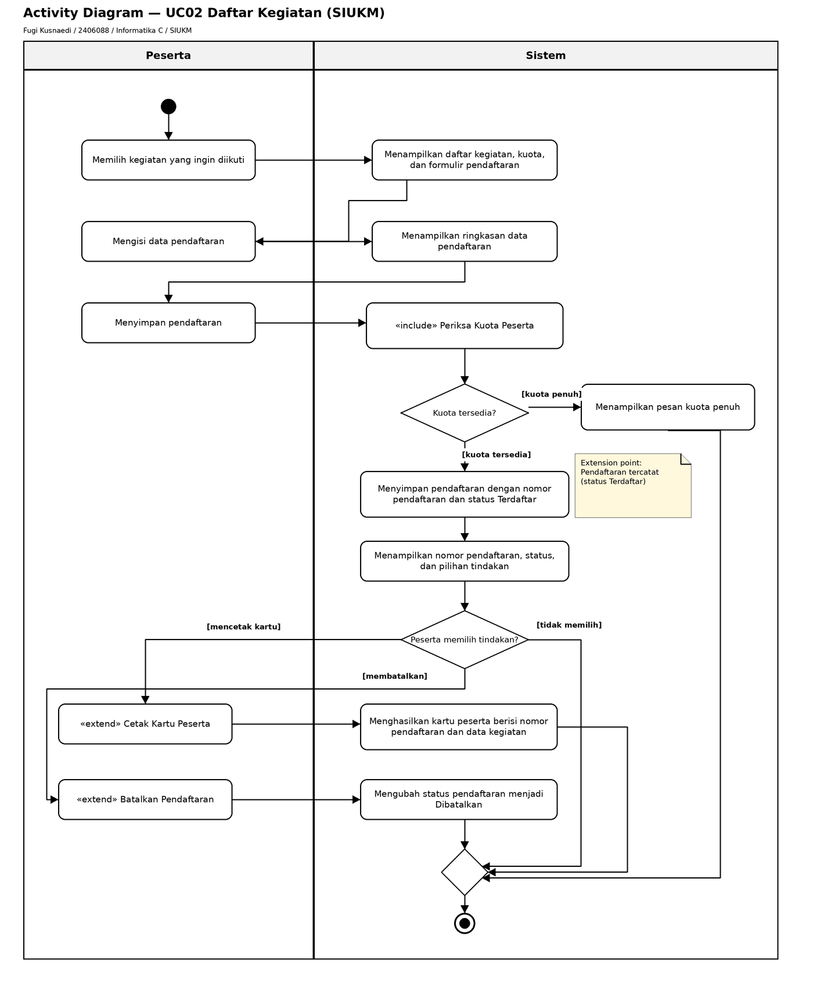

# UTS Praktikum Analisis dan Desain Berorientasi Objek — SIUKM

## Identitas Mahasiswa

| Field | Isi |
|---|---|
| Nama | Fugi Kusnaedi |
| NIM | 2406088 |
| Kelas | Informatika C |
| Paket soal | SIUKM — Sistem Informasi Pendaftaran Kegiatan UKM Kampus |
| Mata kuliah | Praktikum Analisis dan Desain Berorientasi Objek |
| Program studi / semester | S1 Teknik Informatika / Semester 5 |
| Tanggal | 20 November 2026 |
| Repository | <https://github.com/igufdev-bijak/UTS-Prak.ABDO-2406088-SIUKM-Informatika-C> |

## Kasus

**SIUKM — Sistem Informasi Pendaftaran Kegiatan UKM Kampus**

Unit Kegiatan Mahasiswa (UKM) kampus membuka kegiatan setiap semester, antara lain pelatihan, lomba, dan bakti sosial. Peserta, yaitu Mahasiswa dan Dosen, dapat melihat daftar kegiatan UKM beserta kuota pesertanya, lalu mendaftar pada kegiatan yang kuotanya masih tersedia. Sebelum pendaftaran disimpan, sistem memeriksa kuota peserta kegiatan yang dipilih. Pendaftaran yang tercatat berstatus **Terdaftar** dan peserta dapat mencetak kartu peserta setelah pendaftaran tercatat. Peserta dapat membatalkan pendaftaran yang belum dikonfirmasi, sehingga status pendaftaran berubah menjadi **Dibatalkan**. Status pendaftaran adalah **Terdaftar** dan **Dibatalkan**. Pengurus UKM menambah, mengubah, dan menghapus data kegiatan. Peserta juga dapat mengusulkan kegiatan baru, dan Pembina UKM menyetujui usulan kegiatan tersebut.

## Daftar Berkas

| Folder | Berkas | Keterangan |
|---|---|---|
| `01_usecase` | [`UTS_2406088_SIUKM_usecase_v01.drawio`](01_usecase/UTS_2406088_SIUKM_usecase_v01.drawio) | Sumber Use Case Diagram (draw.io) |
| `01_usecase` | [`UTS_2406088_SIUKM_usecase_v01.png`](01_usecase/UTS_2406088_SIUKM_usecase_v01.png) | Pratinjau Use Case Diagram |
| `02_skenario` | [`UTS_2406088_SIUKM_skenario_v01.drawio`](02_skenario/UTS_2406088_SIUKM_skenario_v01.drawio) | Tabel Use Case Skenario UC02 |
| `03_activity` | [`UTS_2406088_SIUKM_activity_v01.drawio`](03_activity/UTS_2406088_SIUKM_activity_v01.drawio) | Sumber Activity Diagram (draw.io) |
| `03_activity` | [`UTS_2406088_SIUKM_activity_v01.png`](03_activity/UTS_2406088_SIUKM_activity_v01.png) | Pratinjau Activity Diagram |

### Checklist Kesesuaian Soal

| No | Ketentuan | Bukti |
|---:|---|---|
| 1 | Tugas 1: use case diagram lengkap | 5 aktor, 11 use case, 15 relasi, boundary sistem |
| 2 | Tugas 1: asosiasi, generalisasi aktor, generalisasi use case, include, extend | Semua jenis relasi hadir pada diagram |
| 3 | Tugas 1: condition dan extension point extend | Dua callout `«extend»` + note lengkap |
| 4 | Tugas 1: notasi UML 2.5.1 | Aktor UML, ellipse use case, panah generalisasi/open-arrow include–extend, note |
| 5 | Tugas 2: satu use case | UC02 Daftar Kegiatan |
| 6 | Tugas 2: field Nama use case, Aktor, Tujuan, Deskripsi | Ada pada tabel `.drawio` dan ringkasan README |
| 7 | Tugas 2: Skenario Normal, Alternative, Akhir | Ada; penomoran 1–14 berlanjut |
| 8 | Tugas 2: include dirujuk nama, tidak ditulis ulang | Langkah 6 merujuk UC03 Periksa Kuota Peserta |
| 9 | Tugas 2: extend sebagai cabang bersyarat | Langkah 11–14 memuat condition + extension point |
| 10 | Tugas 3: use case sama dengan Tugas 2 | UC02 Daftar Kegiatan |
| 11 | Tugas 3: swimlane, decision, guard, cabang alternatif, cabang extend | 2 swimlane, 2 decision, 5 guard, 2 action `«extend»` |
| 12 | Tugas 3: include sebagai satu action | Node A5 `«include» Periksa Kuota Peserta` |
| 13 | Tugas 3: konsisten dengan tabel skenario | Tabel pemetaan langkah → node di bawah |
| 14 | Pengumpulan: repo publik, tiga folder, README | Repo publik dengan struktur sesuai |
| 15 | Identitas nama, NIM, kelas pada setiap berkas | Tertera pada judul/subjudul semua artefak |

---

## Tugas 1 — Use Case Diagram

### Aktor

| Aktor | Kedudukan |
|---|---|
| `Peserta` | Aktor umum untuk seluruh layanan peserta kegiatan UKM |
| `Mahasiswa` | Aktor khusus, generalisasi dari `Peserta` |
| `Dosen` | Aktor khusus, generalisasi dari `Peserta` |
| `Pengurus UKM` | Aktor mandiri; mengelola data kegiatan |
| `Pembina UKM` | Aktor mandiri; menyetujui usulan kegiatan |

`Mahasiswa` dan `Dosen` tidak dibedakan perilakunya oleh narasi, sehingga keduanya digambarkan sebagai aktor khusus yang mewarisi seluruh asosiasi `Peserta`.

### Use Case

| ID | Nama Use Case | Aktor / Peran |
|---|---|---|
| UC01 | Lihat Daftar Kegiatan | Peserta |
| UC02 | Daftar Kegiatan | Peserta; include UC03; diperluas UC04 dan UC05 |
| UC03 | Periksa Kuota Peserta | Perilaku yang di-include oleh UC02 |
| UC04 | Cetak Kartu Peserta | Peserta; extend ke UC02 |
| UC05 | Batalkan Pendaftaran | Peserta; extend ke UC02 |
| UC06 | Usulkan Kegiatan Baru | Peserta |
| UC07 | Setujui Usulan Kegiatan | Pembina UKM |
| UC08 | Kelola Data Kegiatan | Pengurus UKM; use case umum UC09–UC11 |
| UC09 | Tambah Data Kegiatan | Pengurus UKM; generalisasi dari UC08 |
| UC10 | Ubah Data Kegiatan | Pengurus UKM; generalisasi dari UC08 |
| UC11 | Hapus Data Kegiatan | Pengurus UKM; generalisasi dari UC08 |

### Relasi

| No | Jenis Relasi | Dari | Ke |
|---:|---|---|---|
| 1 | Asosiasi | Peserta | UC01 Lihat Daftar Kegiatan |
| 2 | Asosiasi | Peserta | UC02 Daftar Kegiatan |
| 3 | Asosiasi | Peserta | UC04 Cetak Kartu Peserta |
| 4 | Asosiasi | Peserta | UC05 Batalkan Pendaftaran |
| 5 | Asosiasi | Peserta | UC06 Usulkan Kegiatan Baru |
| 6 | Asosiasi | Pengurus UKM | UC08 Kelola Data Kegiatan |
| 7 | Asosiasi | Pembina UKM | UC07 Setujui Usulan Kegiatan |
| 8 | Generalisasi aktor | Mahasiswa | Peserta |
| 9 | Generalisasi aktor | Dosen | Peserta |
| 10 | Generalisasi use case | UC09 Tambah Data Kegiatan | UC08 Kelola Data Kegiatan |
| 11 | Generalisasi use case | UC10 Ubah Data Kegiatan | UC08 Kelola Data Kegiatan |
| 12 | Generalisasi use case | UC11 Hapus Data Kegiatan | UC08 Kelola Data Kegiatan |
| 13 | Include | UC02 Daftar Kegiatan | UC03 Periksa Kuota Peserta |
| 14 | Extend | UC04 Cetak Kartu Peserta | UC02 Daftar Kegiatan |
| 15 | Extend | UC05 Batalkan Pendaftaran | UC02 Daftar Kegiatan |

Jumlah relasi: **7 asosiasi + 2 generalisasi aktor + 3 generalisasi use case + 1 include + 2 extend = 15 relasi**.

**Condition dan extension point untuk relasi extend:**

| Relasi | Condition | Extension Point |
|---|---|---|
| UC04 → UC02 | `[pendaftaran berstatus Terdaftar dan peserta memilih mencetak kartu peserta]` | `Pendaftaran tercatat` |
| UC05 → UC02 | `[pendaftaran berstatus Terdaftar dan belum dikonfirmasi serta peserta memilih membatalkan]` | `Pendaftaran tercatat` |

Pada diagram, kedua relasi extend memakai callout ringkas `«extend» [mencetak]` / `«extend» [membatalkan]` dan `EP: Pendaftaran tercatat` agar tidak menutupi use case; condition lengkap tercantum pada note di dalam boundary.

---

## Tugas 2 — Use Case Skenario

Use case yang dipilih: **UC02 Daftar Kegiatan**.

Alasan pemilihan: use case ini mencakup seluruh jenis relasi yang diminta, yaitu include (pemeriksaan kuota sebelum penyimpanan), extend (cetak kartu peserta dan batalkan pendaftaran setelah pendaftaran tercatat), serta cabang alternatif (kuota penuh).

### Metadata

| Field | Isi |
|---|---|
| Nama use case | UC02 Daftar Kegiatan |
| Aktor | Peserta (berlaku untuk Mahasiswa dan Dosen) |
| Tujuan | Peserta memperoleh pendaftaran kegiatan UKM yang kuotanya masih tersedia, dengan status Terdaftar. |
| Deskripsi | Peserta memilih kegiatan, mengisi data pendaftaran, lalu menyimpan pendaftaran. Sebelum disimpan, sistem menjalankan Periksa Kuota Peserta (include UC03). Pendaftaran tersimpan berstatus Terdaftar. Setelah pendaftaran tercatat, Peserta dapat mencetak kartu peserta atau membatalkan pendaftaran yang belum dikonfirmasi melalui perilaku extend. |

### Kegiatan dan Respon Sistem

| No | Kegiatan | Respon sistem |
|---:|---|---|
| 1 | Peserta membuka fungsi Daftar Kegiatan dan memilih kegiatan yang ingin diikuti. | — |
| 2 | — | Sistem menampilkan daftar kegiatan beserta kuota peserta dan formulir pendaftaran. |
| 3 | Peserta mengisi data pendaftaran. | — |
| 4 | — | Sistem menampilkan ringkasan data pendaftaran. |
| 5 | Peserta menyimpan pendaftaran. | — |
| 6 | — | Sistem menjalankan **Periksa Kuota Peserta** (include UC03; langkah UC03 tidak ditulis ulang). |
| 7 | — | Sistem menyimpan pendaftaran dengan nomor pendaftaran dan status **Terdaftar**. |
| 8 | — | Sistem menampilkan nomor pendaftaran, status Terdaftar, dan pilihan cetak kartu atau batalkan. |
| 9 | Kuota kegiatan sudah penuh saat pemeriksaan (cabang dari langkah 6). | — |
| 10 | — | Sistem menolak penyimpanan dan menampilkan pesan kuota penuh; tidak ada pendaftaran tersimpan. |
| 11 | Peserta memilih mencetak kartu peserta. **Condition:** `[pendaftaran berstatus Terdaftar dan peserta memilih mencetak kartu peserta]`. **Extension point:** `Pendaftaran tercatat`. | — |
| 12 | — | Sistem menghasilkan kartu peserta berisi nomor pendaftaran dan data kegiatan. |
| 13 | Peserta memilih membatalkan pendaftaran. **Condition:** `[pendaftaran berstatus Terdaftar dan belum dikonfirmasi serta peserta memilih membatalkan]`. **Extension point:** `Pendaftaran tercatat`. | — |
| 14 | — | Sistem mengubah status pendaftaran menjadi **Dibatalkan**. |

**Skenario Akhir.** Use case selesai jika pendaftaran tersimpan dengan status Terdaftar; kartu peserta dapat dicetak setelah pendaftaran tercatat; status menjadi Dibatalkan jika Peserta membatalkan pendaftaran yang belum dikonfirmasi; jika kuota penuh, tidak ada pendaftaran yang tersimpan.

---

## Tugas 3 — Activity Diagram

Use case yang digambarkan sama dengan Tugas 2, yaitu **UC02 Daftar Kegiatan**.

| Elemen | Implementasi |
|---|---|
| Swimlane | `Peserta` dan `Sistem` |
| Decision | `Kuota tersedia?` (D1) dan `Peserta memilih tindakan?` (D2) |
| Guard | `[kuota tersedia]`, `[kuota penuh]`, `[mencetak kartu]`, `[membatalkan]`, `[tidak memilih]` |
| Cabang alternatif | D1 → `[kuota penuh]` → `Menampilkan pesan kuota penuh` |
| Cabang extend | D2 → `[mencetak kartu]` → `«extend» Cetak Kartu Peserta`; D2 → `[membatalkan]` → `«extend» Batalkan Pendaftaran` |
| Include | Node A5 `«include» Periksa Kuota Peserta`, digambarkan sebagai satu action dalam alur sebelum penyimpanan |
| Merge | Semua cabang bertemu di merge sebelum aktivitas akhir |
| Initial / Final | Initial di swimlane `Peserta`, final di swimlane `Sistem` |

### Pemetaan Skenario ke Activity

| Langkah skenario | Node activity |
|---:|---|
| 1 | A1 Memilih kegiatan yang ingin diikuti |
| 2 | A2 Menampilkan daftar kegiatan, kuota, dan formulir pendaftaran |
| 3 | A3 Mengisi data pendaftaran |
| 4 | A3B Menampilkan ringkasan data pendaftaran |
| 5 | A4 Menyimpan pendaftaran |
| 6 | A5 `«include» Periksa Kuota Peserta` |
| 6 (guard tersedia) | D1 `[kuota tersedia]` |
| 7 | A6 Menyimpan pendaftaran dengan nomor dan status Terdaftar |
| 8 | A7 Menampilkan nomor pendaftaran, status, dan pilihan tindakan |
| 9–10 | D1 `[kuota penuh]` → A12 Menampilkan pesan kuota penuh |
| 11–12 | D2 `[mencetak kartu]` → A8 `«extend» Cetak Kartu Peserta` → A10 Menghasilkan kartu peserta |
| 13–14 | D2 `[membatalkan]` → A9 `«extend» Batalkan Pendaftaran` → A11 Mengubah status menjadi Dibatalkan |
| — | D2 `[tidak memilih]` → MERGE → FINAL |

---

## Asumsi

1. Status pendaftaran yang tercantum pada narasi adalah **Terdaftar** dan **Dibatalkan**; status **Menunggu Pembayaran** tidak digunakan karena tidak disebutkan pada kasus SIUKM.
2. Frasa "belum dikonfirmasi" diartikan sebagai pendaftaran berstatus Terdaftar yang belum melewati batas konfirmasi Pengurus UKM; pembatalan hanya diperbolehkan pada kondisi tersebut.
3. `Periksa Kuota Peserta` dijadikan use case tersendiri karena merupakan perilaku wajib yang dijalankan setiap kali pendaftaran akan disimpan, sehingga tepat dimodelkan dengan `«include»`.
4. `Cetak Kartu Peserta` dan `Batalkan Pendaftaran` bersifat opsional dan hanya dapat terjadi setelah pendaftaran tercatat, sehingga dimodelkan dengan `«extend»` pada extension point `Pendaftaran tercatat`.
5. `Mahasiswa` dan `Dosen` memiliki perilaku yang identik menurut narasi, sehingga keduanya merupakan generalisasi dari `Peserta` tanpa asosiasi tambahan.
6. Pengurus UKM tidak diberi use case cetak laporan karena tidak disebutkan pada narasi.

## Ekspor Ulang PNG dari draw.io

Berkas `.png` pada repo ini dihasilkan dari layout yang sama dengan sumber `.drawio`. Jika dosen mensyaratkan ekspor langsung dari draw.io:

1. Buka <https://app.diagrams.net> → **Device** → pilih berkas `.drawio` pada folder `01_usecase` atau `03_activity`.
2. Pilih **Exports → as PNG…**.
3. Setting: **Zoom = 100%**, **Border = 0**, transparansi dimatikan, nama berkas sesuai konvensi.
4. Simpan menimpa berkas `.png` yang sudah ada, lalu `git add`, `git commit`, dan `git push`.

## Versi

| Versi | Tanggal | Keterangan |
|---|---|---|
| v01 | 20 November 2026 | Artefak awal UTS SIUKM: use case diagram, tabel skenario UC02, activity diagram UC02 |

Tag `v01` merujuk ke commit terakhir paket ini.
